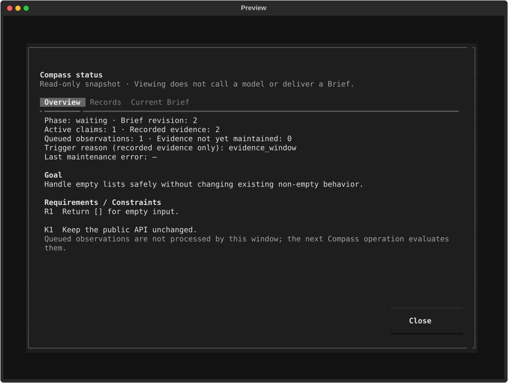

# Compass 命令审核说明

日期：2026-11-23。代码在 Downloads/iCode-brief，分支 codex/compass-modular-latest-20261119。本轮获得了“允许最小 TUI 接线”的明确授权。

## 两个命令做什么

| 命令 | 行为 | 是否调用模型 |
| --- | --- | --- |
| `/compass` | 先进入创建/更新要求的流程，再进入 Brief 维护检查；完成后弹窗展示结果和当前 Brief | 由已有 gate 决定，可能调用界面所选模型；不是每次都调用 |
| `/compass status` | 弹窗展示当前会话已有状态 | 不调用模型，不处理待收集观察，不保存新状态 |

`/compass` 不是强制更新。正常情况下，每次都依次调用现有 `update_requirements()` 和 `update_brief()`：用户原文和仓库上下文没变，就跳过要求提取；未达到 Brief 维护条件，就返回 unchanged。第一步失败会停止后续步骤，并显示错误，不能伪装成两步成功。

例如：Agent 已收到“修复空列表输入”，随后读了仓库文件。你输入 `/compass`，Compass 会使用此前捕获的原始要求和这些观察检查更新。马上再次输入 `/compass`，两个检查仍会经过，但没有新信息时不会重复调用模型。命令文本自身不会成为任务要求。

如果尚未发送过任务，界面会提示先发送任务；不会把 `/compass` 当作任务生成要求。当前 Agent 未开启 compass Extension 时，会提示开启，不会借用其他会话的数据。

## 状态弹窗

沿用旧 Compass 详情弹窗的分组、滚动内容、居中边框和 Esc/Close 关闭方式。参考代码是 CodeHelix-Plugin 中的 `compass_brief/chrys/tui`；此前提供的 CodeHelix-RSI 分支没有找到可直接复用的 TUI 弹窗。

弹窗分为三个页签：

- **Overview**：Goal、Requirements / Constraints、维护阶段、Brief 版本、活跃 Claim 数、已有证据数、待收集观察数、尚未维护的证据数、触发原因和最近维护错误。
- **Records**：Claim 的 ID 和内容，以及最近 20 条证据的 ID 和摘要。
- **Current Brief**：当前 Brief 全文。

这是打开时的只读快照，不自动刷新。关闭后重新执行命令可查看新状态。待收集观察不会因为打开窗口而转成证据；窗口会说明这一点。恢复会话后，查看状态直接读取已加载的 Compass checkpoint，不通过 ready/flush 重新恢复或推进业务状态。

模型生成的文本使用纯文本显示并过滤终端控制字符，不解析 Rich 标记。当前新增窗口使用英文文案，独立放在 Compass 下；iCode 的翻译提取器目前只扫描 src/chrys，本轮没有扩大它的扫描范围。

下图为实际 Textual 渲染的布局预览，使用合成示例数据，不是实验或真实会话结果：



## 调用流程

```text
原生输入框
  → 原生 slash command 注册 / 分发
  → Compass dispatch（校验当前会话、是否启用、是否忙碌）
      /compass
        → Compass 维护弹窗拥有的 worker
        → update_requirements → 原有 gate → 要求提取或去重跳过
        → update_brief → 原有 gate → 维护或 unchanged
        → 显示结果和 Brief
      /compass status
        → status_snapshot（只读内存 / 已加载 checkpoint）
        → 状态弹窗
```

手动命令不会创建主 Agent 回合，不会修改对话历史，也不会把“人看过 Brief”标记成“Agent 已消费 Brief”。Brief 继续保存在原来的 Compass 账本中；Agent 仍通过现有 Compass 工具获取反馈。本轮没有另加自动向模型上下文投递 Brief 的通道。

维护期间遮住主输入框，避免从该界面启动另一项操作；Close 和 Esc 在维护完成后可关闭。退出应用时由 Textual 取消弹窗拥有的 worker。Agent 正在执行或 Compass 正在维护时，手动维护被拒绝；查看状态仍可用。两个步骤分别沿用原有 gate 锁，不新增引擎级执行租约，也不声称能拦住其他进程或非 TUI 调用者发起的操作。

## 本轮改了哪些原版 iCode 文件

仅两个文件，共新增 22 行；不修改 runner.py，也不修改执行循环：

| 文件 | 为什么改 |
| --- | --- |
| `src/chrys/app/tui/screens/main/commands.py` | 注册 `/compass`、`status` 补全、`/man compass` 帮助，并转发到动作回调；命令定义和业务处理都在 Compass |
| `src/chrys/app/tui/screens/main/screen.py` | 将当前 engine、当前会话 ID 和忙碌状态传给 Compass dispatcher |

这是本轮增量，不代表整条开发分支只有这两个 host 改动。此前的 builder 模型及生命周期接线仍保留。

## Compass 中的实现文件

| 文件 | 职责 |
| --- | --- |
| `adapters/icode/commands.py` | 组合两个现有工具操作；构造不可变只读快照 |
| `adapters/icode/tui/command.py` | 命令定义、会话/忙碌校验、维护进度与结果弹窗 |
| `adapters/icode/tui/status.py` | 状态弹窗布局和安全纯文本显示 |
| `adapters/icode/tool_session.py` | 增加按会话目录和 ID 查找当前已绑定 runtime 的只读入口 |

gate、平铺业务模块、provenance 和独立评测路径不改。新增入口复用已有 SelectedModel，不另配模型或密钥。

## 如何自己验收

1. 在此仓库启动 `uv run icode`，在 Agent 的 Tools → Extensions 开启 compass。
2. 先输入一个正常任务，例如“读一下这个项目，说明空列表输入在哪里处理”。等 Agent 完成当前回合。
3. 输入 `/compass`。应出现维护进度，随后显示维护结果。无新信息时允许显示 unchanged，这不是故障。
4. 再输入一次 `/compass`。检查不会被省略，但去重和触发门槛仍生效。
5. 输入 `/compass status`。查看三个页签，Esc 或 Close 退出；打开窗口本身不会新增维护调用。
6. 在 Agent 工作时输入 `/compass` 应提示等待；`/compass status` 仍可查看快照。
7. `/new` 后先看状态或尝试维护，不应显示旧会话数据；尚无任务时维护应提示先发送任务。

## 验证记录

只执行本轮新增文件：

```bash
UV_CACHE_DIR=/private/tmp/compass-tool-uv uv run --no-sync pytest -q -n0 tests/integration/compass/test_commands_status.py
```

结果：**13 passed**。覆盖原生输入框到命令处理、重复检查与去重、缺失要求初始化、已有证据触发、重启后只读快照、大小两种窗口、纯文本显示、会话不匹配、未启用/无任务/忙碌拒绝、维护错误、维护期间防关闭、应用退出取消 worker。全部使用离线模型替身，没有付费调用；未运行旧测试或全量测试。

使用已有 Python 3.14.0 环境，未更改上游 3.14.10 固定要求。未提交、未推送。

补充校验：修改文件的 Ruff 检查、格式检查和类型检查均通过。与上一轮 host 哈希快照对比，仅上述两个 TUI 文件变化；runner.py 未变，provenance 中的业务文件哈希全部匹配，冻结复现仓库仍为 clean。


## 原生命令补全修复（2026-11-23）

原生输入框在选中带子命令的 `/compass` 时会先打开子菜单，不立即调用默认操作。此前菜单只有状态项，且标签没有显示 `status`，所以继续回车会进入状态弹窗，看不到维护入口。

现在子菜单第一项为 `/compass — Update task requirements and Brief`，第二项为 `status — View Compass status`。选择第一项或默认继续回车进入维护；输入 `/compass st` 会补全状态项，完整 `/compass status` 也可直接执行。未知参数如 `/compass nonsense` 只提示正确用法，不打开弹窗、不调用模型。

此次仅修改 Compass 的 `adapters/icode/tui/command.py` 菜单定义，没有修改 iCode 通用补全或 runner。已运行的 TUI 需要退出后重新启动才能加载修改。

新增键盘回归测试：`tests/integration/compass/test_command_keyboard.py`，覆盖完整命令、部分补全、默认维护选择及错误参数；使用离线模型替身，不产生付费调用。本次仅运行此新增文件，结果 **1 passed**（一个键盘场景覆盖上述四条路径）；Ruff 和格式检查通过，未运行旧测试或全量测试。


## 2026-11-23 维护触发修正

显式 Brief 检查新增要求重评和待处理测试结果的触发分支；上文“只按原窗口判断”的说明以[维护衔接修复](MAINTENANCE_REFRESH_REVIEW.md)为准。普通工具不自动维护，重复检查仍去重。界面中的版本已改称 Record revision，并显示处理游标和等待窗口。


分组弹窗更新：三页签方案已替换为设计文档中的八组折叠与详情导航；见 [POPUP_GROUPS_REVIEW.md](POPUP_GROUPS_REVIEW.md)。
